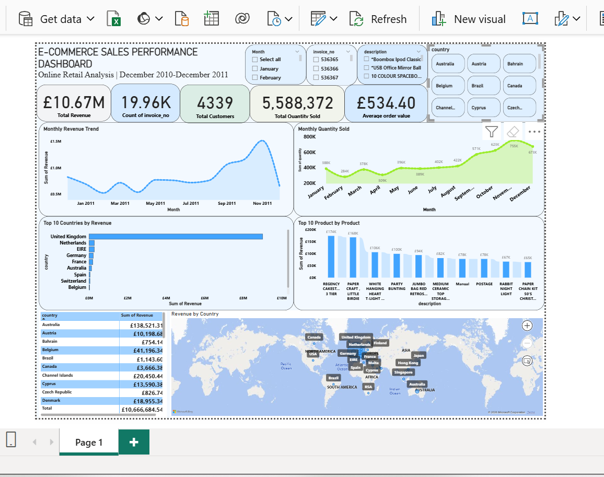

## Dashboard Preview

# e-commerce-sales-analysis
End-to-end e-commerce sales analysis using PostgreSQL and Power BI

# E-Commerce Sales Performance Analysis
📊 Project Overview
This project is an end-to-end E-Commerce Sales Performance Analysis using the UCI Online Retail dataset.
The project demonstrates a practical data analytics workflow:
Data Extraction → Data Profiling → SQL Data Cleaning → SQL Analysis → Power BI Visualization → Business Insights → Recommendations

The objective was to transform raw transactional data into meaningful business insights around revenue, orders, customers, products, sales trends, and geographic perfor

Business Problem
An e-commerce business needs to understand its sales performance in order to identify:
-Overall revenue performance
-Monthly sales trends
-High-performing products
-Major revenue-generating countries
-Customer activity
-Average order value
-Changes in sales volume over time
This project uses transactional sales data to answer these questions and present the results through an interactive Power BI dashboard.

Project Objectives
The main objectives were to:
-Assess the quality and structure of the raw transactional data.
-Prepare a separate cleaned dataset without modifying the original data.
-Analyze overall sales performance using PostgreSQL.
-Identify high-performing products.
-Analyze revenue by country.
-Identify monthly revenue trends.
-Calculate key business KPIs.
-Build an interactive Power BI dashboard.
-Derive actionable business insights and recommendations.

Dataset
The project uses the Online Retail dataset from the UCI Machine Learning Repository.
The dataset contains 541,909 transaction records from a UK-based online retailer and covers transactions from 1 December 2010 to 9 December 2011. The retailer mainly sells unique all-occasion gifts, with many customers being wholesalers.
Source
UCI Machine Learning Repository — Online Retail
Dataset DOI: 10.24432/C5BW33
The dataset is licensed under CC BY 4.0.

Tools Used

-Excel / CSV
Initial data handling
-PostgreSQL
Data extraction, profiling, cleaning and analysis
-pgAdmin
PostgreSQL database management
-Power BI
Data visualization and dashboard development
-DAX
Calculated columns and measures
-GitHub
Project documentation and portfolio presentation

Data Analytics Process
1. Data Extraction
The original Online Retail dataset was imported into PostgreSQL.
A dedicated database and schema were created:
     CREATE DATABASE ecommerce_analytics;

The raw dataset was stored in:
      raw_data.online_retail

The original table was preserved so that the raw data remained available for validation and comparison.

Data Profiling
The raw dataset was examined for:
-Missing values
-Duplicate records
-Negative quantities
-Zero and negative prices
-Cancellation transactions
-Date range
-Customer ID availability
-Product and invoice consistency

Key data-quality findings
Data Quality Check
Result
-Total records
541,909
-Missing Description
1,454
-Missing Customer ID
135,080
-Negative Quantity
10,624
-Cancellation invoices
9,288
-Unit Price = 0
2,519
-Unit Price < 0
2
-Exact duplicate groups
4,879

Customer IDs were retained when available, while missing Customer IDs were not artificially created.

SQL Data Cleaning
A separate cleaned table was created so that the original dataset was not modified.
Cleaned table:
-clean_data.online_retail_clean
-Basic transformations included:
-Removing unnecessary spaces using TRIM()
-Converting blank descriptions and customer IDs to NULL
-Standardizing column names
-Preserving the original raw dataset
-Preparing the cleaned table for analysis
Example:
CREATE TABLE clean_data.online_retail_clean AS
SELECT
    TRIM("InvoiceNo") AS invoice_no,
    TRIM("StockCode") AS stock_code,
    NULLIF(TRIM("Description"), '') AS description,
    "Quantity" AS quantity,
    "InvoiceDate" AS invoice_date,
    "UnitPrice" AS unit_price,
    NULLIF(TRIM("CustomerID"), '') AS customer_id,
    TRIM("Country") AS country
FROM raw_data.online_retail;

The cleaned table retained the same 541,909 rows as the raw table.

SQL Analysis
For the main sales analysis, transactions with:
  quantity > 0
  unit_price > 0
were used to calculate sales KPIs.
This prevents zero or negative quantities/prices from distorting the sales-performance calculations.

Overall Business KPIs
SELECT
    SUM(quantity * unit_price) AS total_revenue,
    COUNT(DISTINCT invoice_no) AS total_orders,
    SUM(quantity) AS total_quantity_sold,
    COUNT(DISTINCT customer_id) AS total_customers
FROM clean_data.online_retail_clean
WHERE unit_price > 0
  AND quantity > 0;
Result 
KPI
-Total Revenue
£10,666,684.54
-Total Orders
19,960
-Total Quantity Sold
5,588,372
-Identifiable Customers
4,338

Average Order Value
Average Order Value was calculated as:

SELECT
    SUM(quantity * unit_price)
    / COUNT(DISTINCT invoice_no) AS average_order_value
FROM clean_data.online_retail_clean
WHERE unit_price > 0
  AND quantity > 0;

Result
Average Order Value = £534.40

Monthly Revenue Analysis
SELECT
    DATE_TRUNC('month', invoice_date) AS month,
    SUM(quantity * unit_price) AS monthly_revenue,
    COUNT(DISTINCT invoice_no) AS total_orders
FROM clean_data.online_retail_clean
WHERE unit_price > 0
  AND quantity > 0
GROUP BY DATE_TRUNC('month', invoice_date)
ORDER BY month;

Key finding
November 2011 recorded the highest monthly revenue:
£1,509,496.33 with: 2,769 orders
This represents the strongest monthly revenue performance observed in the analysis period.

Top Products by Revenue
Non-product/service codes such as:
DOT
POST
M
were excluded from the physical-product ranking.
SELECT
    stock_code,
    description,
    SUM(quantity * unit_price) AS total_revenue
FROM clean_data.online_retail_clean
WHERE unit_price > 0
  AND quantity > 0
  AND description IS NOT NULL
  AND stock_code NOT IN ('DOT', 'POST', 'M')
GROUP BY stock_code, description
ORDER BY total_revenue DESC
LIMIT 10;

Top-performing products

-22423
REGENCY CAKE STAND 3 TIER
£174,484.74
-23843
PAPER CRAFT, LITTLE BIRDIE
£168,469.60
-85123A
WHITE HANGING HEART-LIGHT HOLDER
£104,340.29

The Power BI dashboard expands this into a Top 10 Products by Revenue visualization.

Revenue by Country
SELECT
    country,
    SUM(quantity * unit_price) AS total_revenue,
    COUNT(DISTINCT invoice_no) AS total_orders
FROM clean_data.online_retail_clean
WHERE unit_price > 0
  AND quantity > 0
GROUP BY country
ORDER BY total_revenue DESC
LIMIT 10;

Top revenue-generating countries
-United Kingdom
£9,025,222.08
18,019
-Netherlands
£285,446.34
94
-EIRE
£283,453.96
288
-Germany
£228,867.14
457
-France
£209,715.11
392
-Australia
£138,521.31
57
-Spain
£61,577.11
90
-Switzerland
£57,089.90
54
-Belgium
£41,196.34
98
-Sweden
£38,378.33
36

Power BI Dashboard
The cleaned PostgreSQL table was connected to Power BI using the PostgreSQL connector with Import mode.
A calculated Revenue column was created:
Revenue =
    'online_retail_clean'[quantity]
    * 'online_retail_clean'[unit_price]
A monthly date column was also created:
Month =DATE(YEAR('online_retail_clean'[invoice_date]),
    MONTH('online_retail_clean'[invoice_date]),1)
Average Order Value was created using:
Average Order Value =
DIVIDE(SUM('online_retail_clean'[Revenue]),
    DISTINCTCOUNT('online_retail_clean'[invoice_no]))
Dashboard components
The final dashboard contains:
-Total Revenue
-Total Orders
-Total Customers
-Average Order Value
-Total Quantity Sold
-Monthly Revenue Trend
-Monthly Quantity Sold
-Top 10 Products by Revenue
-Top 10 Countries by Revenue
-Revenue by Country Map

Key Business Insights
1. Strong overall sales performance
The analysis generated approximately £10.67 million in revenue across 19,960 orders.
The average order value was £534.40, providing an important benchmark for evaluating future order performance.
2. November was the strongest revenue month
November 2011 recorded the highest monthly revenue at approximately £1.51 million.
This provides an opportunity to investigate the products, customer activity and seasonal factors that contributed to the increase.
3. Revenue is heavily concentrated in the UK
The United Kingdom generated approximately £9.03 million in revenue, considerably more than any other country in the dataset.
This indicates that the UK was the dominant market during the analysis period.
4. A small group of products generated substantial revenue
Products such as REGENCY CAKE STAND 3 TIER, PAPER CRAFT, LITTLE BIRDIE, and WHITE HANGING HEART-LIGHT HOLDER were among the leading physical products by revenue.
These products can be investigated further for product bundling, promotions and inventory planning.
5. International markets provide additional revenue opportunities
Although the UK dominates revenue, countries such as the Netherlands, EIRE, Germany, France and Australia generated measurable sales.
Further analysis could determine whether these markets have potential for additional growth.

Business Recommendations
Based on the analysis, the following actions could be considered:
1. Investigate the November sales peak
Analyze the products, customers and countries responsible for the November increase to understand whether the growth was driven by seasonality, promotions, product demand or customer purchasing behaviour.
2. Maintain strong performance in the UK
Because the UK accounts for the majority of revenue, maintaining customer retention, product availability and service quality in this market should remain an important consideration.
3. Explore international opportunities
The performance of markets such as the Netherlands, Germany, France and EIRE can be investigated further to identify opportunities for targeted international marketing.
4. Focus on high-revenue products
High-performing products can be analyzed for:
Inventory planning
Cross-selling
Product bundling
Promotional campaigns
Repeat-purchase opportunities
5. Investigate customer purchasing behaviour
A future phase of the project could use customer-level analysis to examine:
Customer frequency
Customer monetary value
Repeat purchases
Customer retention
Customer segmentation

Future Analysis
Possible extensions to this project include:
Customer segmentation using RFM analysis
Customer lifetime value analysis
Repeat-purchase analysis
Customer retention analysis
Product return/cancellation analysis
Country-level customer segmentation
Product profitability analysis if cost data becomes available
Sales forecasting
Cohort analysis

Data Source & Attribution
Chen, D. (2015). Online Retail. UCI Machine Learning Repository.
DOI: 10.24432/C5BW33
The dataset is available through the UCI Machine Learning Repository and is licensed under Creative Commons Attribution 4.0 International (CC BY 4.0).

About the Project
This project was completed as an independent Data Analytics portfolio project to demonstrate practical skills in:
SQL
PostgreSQL
Data Cleaning
Data Analysis
Power BI
DAX
Data Visualization
Business Intelligence
Business Insight Generation
Project focus: Turning raw transactional data into actionable business insights.